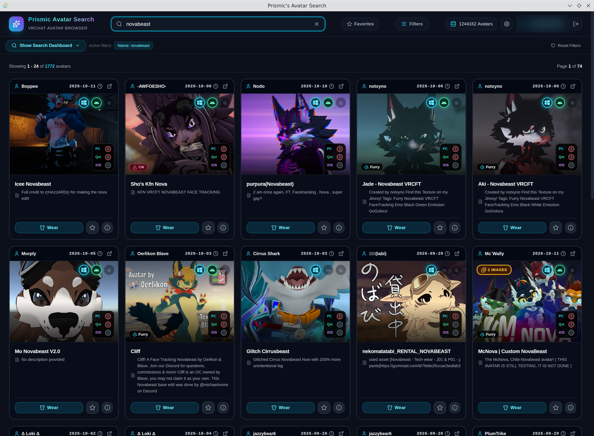
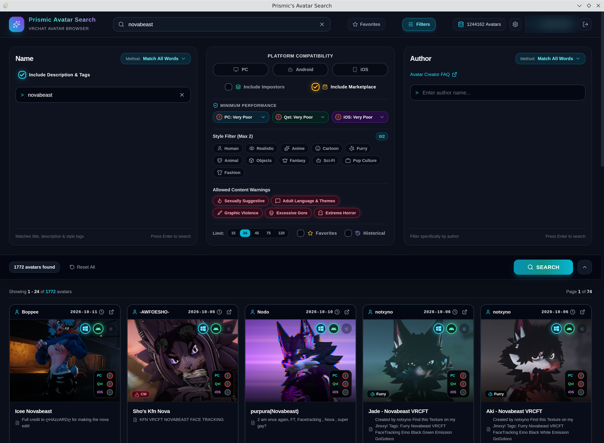
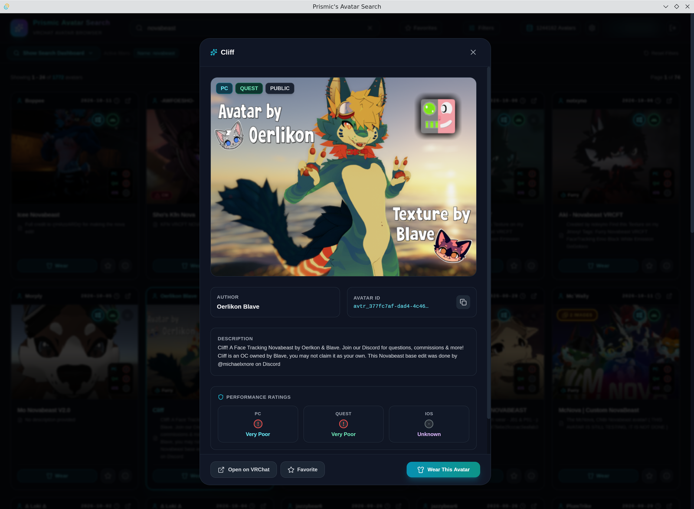

# 🎭 Prismic's Avatar Search

A fast, modern desktop app for searching, browsing, and equipping VRChat avatars — built with **Tauri v2**, **Rust**, **React 19**, **Tailwind CSS**, and **SQLite**.

Search tens of thousands of avatars locally with VRChat-style filters, preview galleries, and wear any public avatar in one click.

## 🖼️ Preview



| Search dashboard & filters | Avatar details & image gallery |
|---|---|
|  |  |

<details>
<summary>Legacy Rust GUI (v1)</summary>


</details>

## 📥 Download

Grab the latest installer from [**GitHub Releases**](https://github.com/FRKFFR/prismic-avatar-search-app/releases/latest):

| Platform | Installer | File |
|---|---|---|
| Windows | NSIS Setup (recommended) | `prismic-avatar-search_*_x64-setup.exe` |
| Windows | MSI | `prismic-avatar-search_*_x64_en-US.msi` |
| Linux | AppImage (any distro) | `prismic-avatar-search_*_amd64.AppImage` |
| Linux | Debian / Ubuntu | `prismic-avatar-search_*_amd64.deb` |
| Linux | Fedora / openSUSE | `prismic-avatar-search-*.x86_64.rpm` |

On Linux, make the AppImage executable (`chmod +x prismic-avatar-search_*.AppImage`) and run it, or install the package with `sudo apt install ./prismic-avatar-search_*_amd64.deb` / `sudo dnf install ./prismic-avatar-search-*.x86_64.rpm`.

On first launch, the app downloads the avatar database (~400 MB) and syncs it into a local SQLite index.

## ✨ Features

### 🔍 VRChat-Style Search
- **5 search methods** for name and author: Match All Words, Match Phrase, Exact Phrase, Starts With, Ends With
- Optionally include descriptions & tags in name search
- Platform filters: **PC / Quest (Android) / iOS**, incl. impostor support
- Minimum performance rank per platform (Excellent → Very Poor, with official VRChat rank icons)
- Style filter (max 2): Human, Realistic, Anime, Cartoon, Furry, Animal, Objects, Fantasy, Sci-Fi, Pop Culture, Fashion
- Content-warning toggles, marketplace filter, impostor toggle
- Result limits: 15 / 24 / 45 / 75 / 120 per page
- Collapsible 3-column filter dashboard — no scrolling to filter

### 🖼️ Images & Gallery
- Rust-side authenticated image proxy with disk caching
- Avatar gallery discovery (embedded `gallery` + files API)
- Optional **historical image revisions** toggle
- Image count badge on cards follows the setting live

### ⭐ Local Favorites
- Star any avatar — stored locally in SQLite, no account needed
- Favorites-only filter with count badge
- Survives database re-syncs and app restarts

### 🗄️ Database
- Downloads & decrypts the Main, Quest, and iOS avatar databases (with fallback mirrors)
- **Auto-updates when the database is older than one day** (max once per day)
- Live sync progress with stage-by-stage feedback
- Indexed SQLite queries — instant search over the full catalog

### 🔐 VRChat Integration
- Login with credentials, **2FA** (email OTP & TOTP), persistent sessions
- **Wear** any public avatar directly from a card or the details modal
- Open avatars on the VRChat website, copy avatar IDs

### 🎨 Interface
- Dark theme modeled on VRChat's in-game avatar search
- Cards show author, last-update date, platform badges, per-platform rank icons, style & content-warning chips
- Avatar details modal with image carousel, tags, ratings, and wear action

## 🛠️ Build from Source

### Prerequisites
- [Node.js](https://nodejs.org/) 18+ and npm
- [Rust toolchain](https://rustup.rs/) 1.77+
- Windows: Visual Studio Build Tools (C++ workload) + WebView2
- Linux (Debian/Ubuntu): `sudo apt install libwebkit2gtk-4.1-dev build-essential curl wget file libxdo-dev libssl-dev libayatana-appindicator3-dev librsvg2-dev` — see [Tauri prerequisites](https://v2.tauri.app/start/prerequisites/#linux) for other distros

### Run

```bash
cd prismic_tauri

# Frontend dev server (browser, with HMR)
npm install
npm run dev

# Standalone desktop app (frontend embedded)
npm run build
cd src-tauri
cargo run --release        # → target/release/app.exe (Windows) / target/release/app (Linux)
```

> ⚠️ `custom-protocol` is enabled in `Cargo.toml`, so `cargo tauri dev` loads the embedded build instead of the Vite dev server. For frontend iteration use `npm run dev` in a browser, then `npm run build` before `cargo build`.

### Release a new version

Pushing a `v*` tag builds installers on GitHub Actions and publishes a release automatically:

```bash
git tag v2.1.0 && git push origin v2.1.0
```

## 📁 Repository Layout

```
prismic_tauri/            # ← The app (Tauri v2)
├── src-tauri/src/        # Rust backend: db, downloader, vrc_api, commands, config
├── src/                  # React frontend: components, api.ts, types.ts
└── src-tauri/tauri.conf.json

prismic_avatar_search/    # Legacy egui/native version (kept for reference)
old/                      # Older experiments
```

## 🔧 Data Locations

| What | Windows | Linux |
|---|---|---|
| Avatar DB + favorites | `%APPDATA%\com.prismic.avatarsearch\avatars.db` | `~/.local/share/com.prismic.avatarsearch/avatars.db` |
| Image & details cache | `%APPDATA%\com.prismic.avatarsearch\cache\` | `~/.local/share/com.prismic.avatarsearch/cache/` |
| Auth/session config | `%APPDATA%\com.prismic.avatarsearch\` | `~/.local/share/com.prismic.avatarsearch/` |

## 🐛 Troubleshooting

- **White window / `ERR_CONNECTION_REFUSED`**: you're running a dev-mode binary — rebuild with `npm run build` then `cargo build --release` (or just download the release installer).
- **Search returns nothing**: open the Database modal (database icon in the header) and re-sync.
- **Login fails**: check 2FA method (email vs authenticator app) and system clock.

## 📄 License

MIT — see [LICENSE](LICENSE).

---

**Made with ❤️ and Rust and sometimes ragequit**
